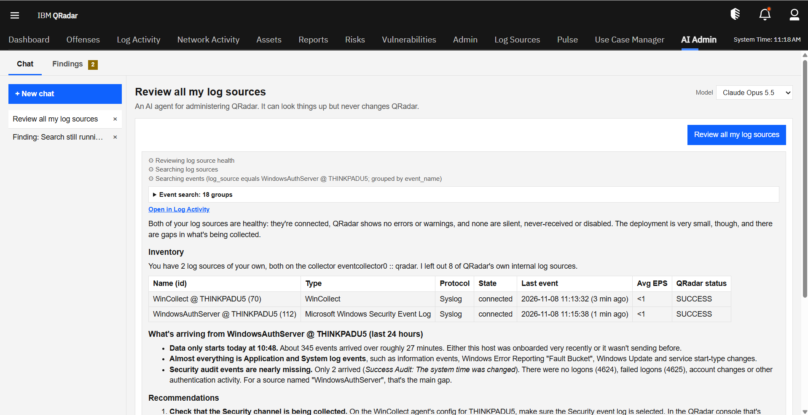
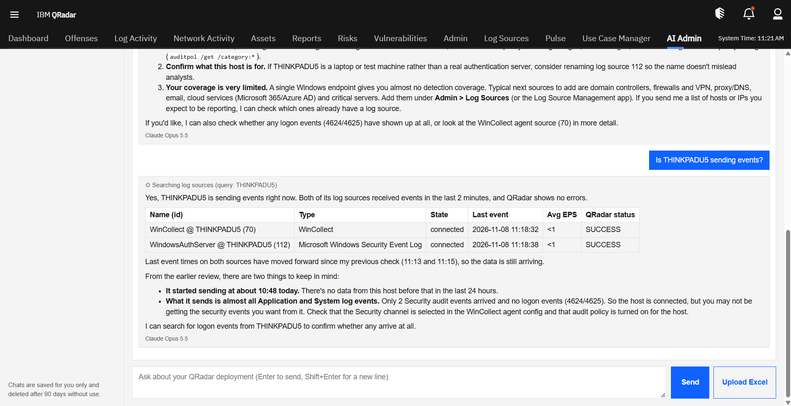
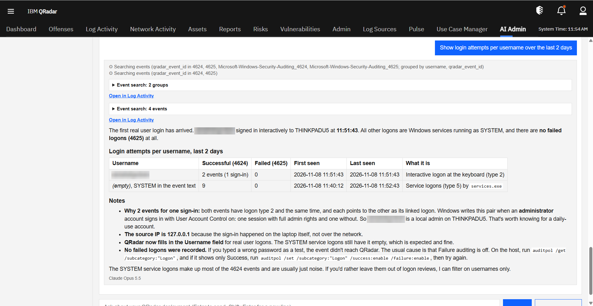
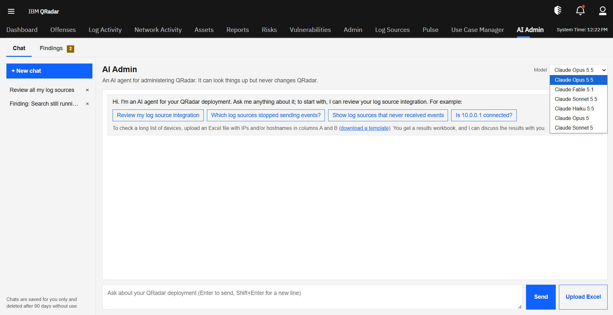
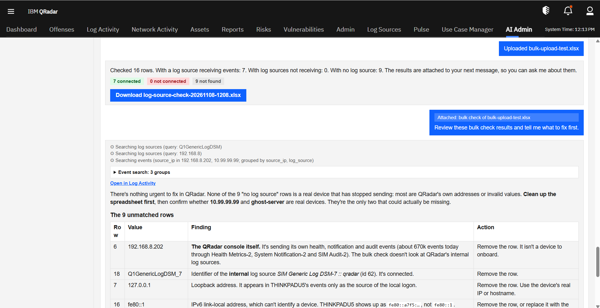
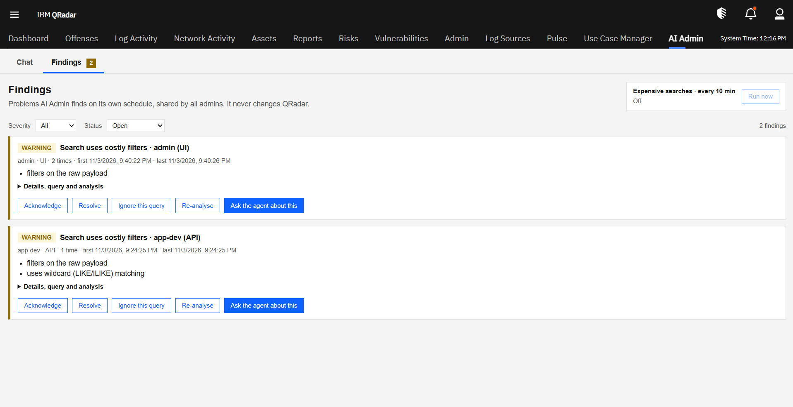
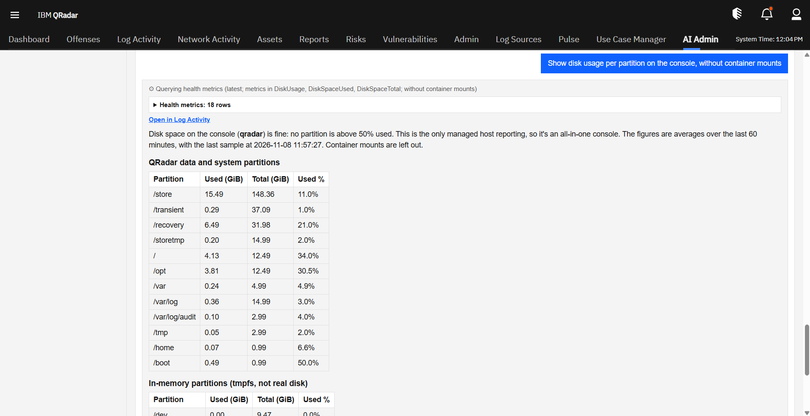
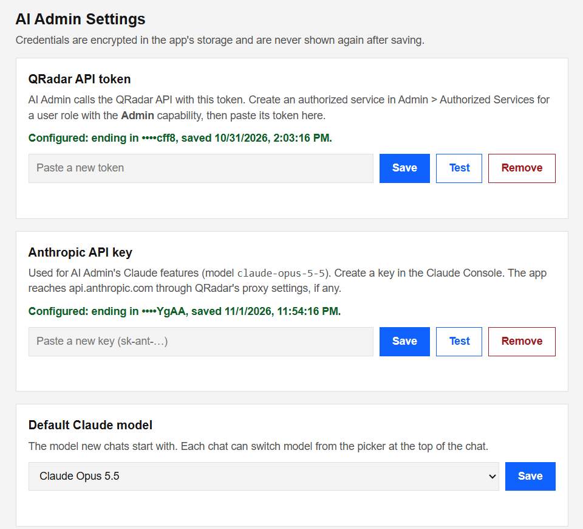
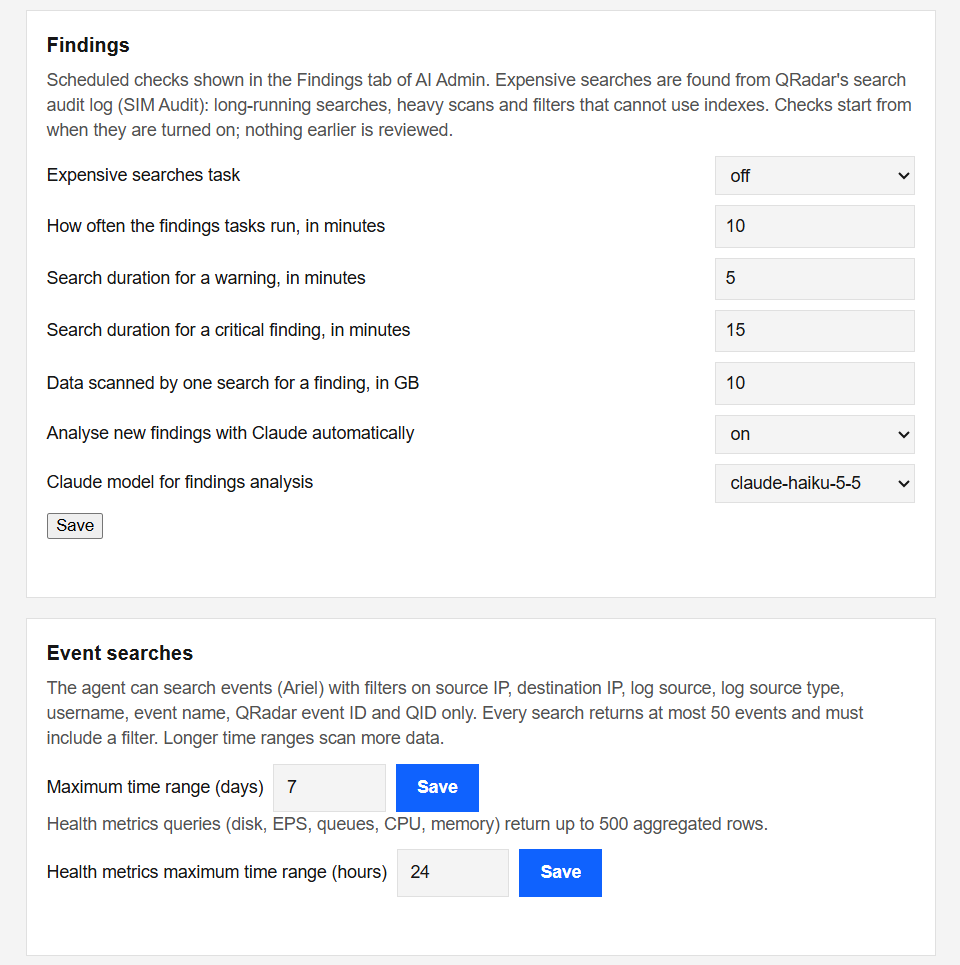

# AI Admin for IBM QRadar

AI Admin is an assistant that runs inside IBM QRadar. QRadar administrators can ask it questions
in plain language, and it watches the deployment for problems on its own schedule. It runs on
Anthropic's Claude.

It works as a new **AI Admin** tab in the QRadar console. It can look things up and explain them,
but it never changes anything in QRadar.

## What it does

### Chat

Ask a question and AI Admin finds the answer in QRadar, for example:

- *"Review my log source integration."* It finds sources that stopped sending, never sent
  anything, or show errors, and puts the most urgent first.
- *"Is 10.1.2.3 connected?"* or *"Is Office 365 sending events?"*
- *"Show login attempts per user over the last two days."*
- *"Show disk usage per partition on the console."* It also covers events per second, memory
  and CPU.

Each answer shows the searches the assistant ran. A link opens the same search in QRadar's Log
Activity tab.

Chats are saved for each administrator. Each chat can use a different Claude model, chosen at the
top of the chat.

### Checking many devices at once

Upload an Excel list of IP addresses and/or hostnames, and AI Admin checks each one. You get back
a spreadsheet that sorts them into **connected**, **not connected** and **not found**. You can
then ask the assistant about the results.

### Findings

AI Admin checks QRadar on a schedule and lists the problems it finds in a **Findings** view. It
starts with **expensive searches**:

- searches that run for a long time;
- searches that read very large amounts of data;
- searches built in ways QRadar can't speed up, such as searching the raw log text.

Each finding says who ran the search and how often, and explains why it is costly and how to fix
it. Administrators can acknowledge, resolve or ignore it, or ask the assistant about it. More
kinds of findings are planned, such as noisy log sources and high event volumes that aren't
needed.

## Use cases

**Morning health check.** Ask *"Review my log source integration"*. You get a list of sources
that stopped sending, never sent anything, or show errors, with what to do about each.

**"Is this device logging?"** A network team asks whether their new firewalls are in QRadar.
Paste the IP addresses into the chat, or upload their Excel list, and get back which are
connected, not connected or not found.

**Looking into a user's logins.** Ask *"Show login attempts for jsmith over the last 24 hours"*.
You get the successful and failed logins with first and last times, and a link that opens the same
search in Log Activity.

**Capacity check.** Ask *"Which partitions are over 50% used?"* or *"What's our EPS trend
today?"*. The answer comes from QRadar's own health metrics, already converted to GB, percent or
events per second.

**Finding searches that slow QRadar down.** The Findings view flags slow and costly searches as
they happen, shows who ran them, and explains how to rewrite them. Click **Ask the agent about
this** to work out a fix in the chat.

## Built to be safe

- **Read-only.** AI Admin can't change QRadar's configuration or data.
- **Administrators only.** Every page and request checks that the user is a QRadar administrator.
- **Searches stay within limits.** The assistant can't write its own QRadar queries. It describes
  what it wants, and AI Admin builds the query from a set of allowed fields, applies limits on
  results, time range and running time, and has QRadar check it before it runs.
- **Credentials are protected.** The QRadar token and the Anthropic API key are stored encrypted
  and never shown again after they are saved.
- **Everything is recorded.** Every search AI Admin runs is logged with who asked for it.

## What you need

- IBM QRadar 7.5.0 Update Package 7 or later.
- A QRadar authorized service token with the Admin capability.
- An Anthropic API key.
- Internet access from QRadar to Anthropic, either directly or through QRadar's proxy.

## Getting started

1. Install the app package in QRadar under **Admin → Extensions Management**.
2. Open **Admin → AI Admin Settings**. Enter the QRadar token and the Anthropic API key, and
   choose the default model.

   

3. Optionally, turn on the expensive searches check and adjust the limits further down the same
   page.

   

4. Open the **AI Admin** tab and start asking.

## Status

AI Admin is in active development and has been tested on a QRadar 7.5.0 test console. It hasn't
yet been tested on a production deployment.
